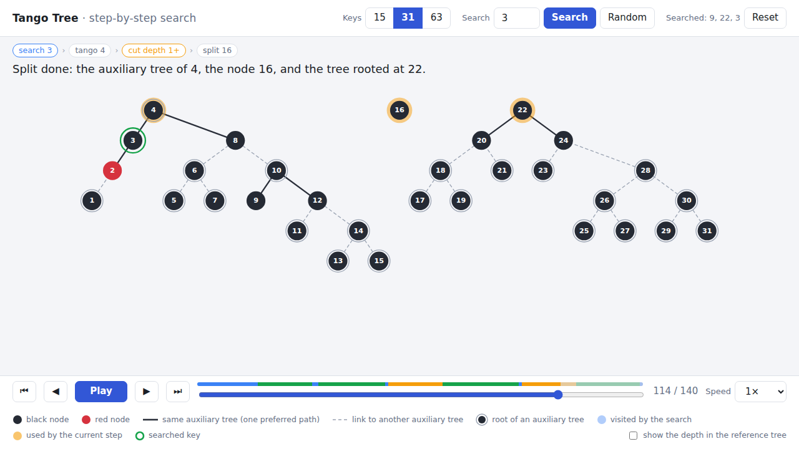

# Tango Tree 

## Overview
This project provides a functional implementation of the **Tango Tree** data structure.

Originally introduced by **Erik D. Demaine, Dion Harmon, John Iacono, and Mihai Pătrașcu**, the Tango Tree is a binary search tree designed to achieve competitive performance with the optimal binary search tree for any access sequence.

The main idea behind the Tango Tree is to represent each **preferred path** as a balanced binary search tree. A preferred path consists of nodes that were most recently traversed during searches in the reference tree for a given access sequence.

To maintain the invariant that nodes belonging to the same preferred path remain grouped together, the structure uses an update procedure—commonly referred to as **tango**—which adjusts the preferred path trees after each search operation.

The Tango Tree is particularly important because it was the first binary search tree structure proven to achieve an **(O(log log n))-competitive ratio** with respect to the optimal offline binary search tree for any search sequence. This marked one of the first major advances toward resolving the **dynamic optimality conjecture**.

> E. D. Demaine, D. Harmon, J. Iacono, and M. Pătrașcu. Dynamic optimality—almost. *SIAM Journal on Computing*, 37(1):240–251, 2007. A preliminary version appeared in FOCS 2004.

<p align="center">
  
  <br/>
  <em>The data structure's name comes from the dance: "The Tango", a vintage postcard by L. Usabal.</em>
</p>

## Getting Started

### Prerequisites 

Before building the project, ensure you have the following installed:

* CMake (v3.14 or higher)

* C++ Compiler: A compiler supporting C++17 (e.g., GCC 7+, Clang 5+, or MSVC 2017+).

* Git: Required by CMake to fetch GoogleTest automatically.

* Python 3 (optional): Required only to run the performance analysis. Its charts also need matplotlib, for example `sudo apt install python3-matplotlib`.

* Emscripten (optional): Required only to rebuild the [visualization](#visualization) after changing the C++ code. To open the visualization, a web browser is enough.

## Project Structure

| Path | Contents |
|---|---|
| `includes/` | The headers of the red-black tree (`RedBlackTree.h`), the Tango Tree (`TangoTree.h`), and the Tango Tree copy that records its steps (`TangoVisualization.h`). |
| `src/` | Their implementations, built as the `RedBlackTree`, `TangoTree` and `TangoVisualization` libraries. |
| `main/` | Three interactive programs: `MainTT` for the Tango Tree, `MainRBT` for the red-black tree, and `MainTV` for the visualization. |
| `visualization/` | The page that shows a search as an animation: `index.html`, `viewer.js`, and `tango.js`, which is `MainTV` compiled to WebAssembly. |
| `tests/unit/` | The GoogleTest unit tests, and the shared `Checkers.h` and `Helpers.h`. |
| `tests/analysis/` | The performance comparison: the benchmark, a splay tree used as a baseline, the comparison script. |

## Installation & Building

This project uses CMake to automate the build process. Follow these steps to compile:

1. **Clone the repository (using URL):**
    ```bash
    git clone https://github.com/Za0Warudo/TangoTree.git
    cd TangoTree
    ```

2. **Configure the project:**
This step creates a build directory and generates the necessary build files.
    ```bash
     cmake -S . -B build
     ```
3. **Build the project:**
This compiles the source code and the test suite.
    ```bash
    cmake --build build
    ```

### Running Unit Tests

Since GoogleTest is integrated via CMake, the tests are compiled together with the project. Run these commands from the repository root, after configuring the project. The build step recompiles anything that changed, so your latest test and source edits are always included.

**Run all the test files:**
```bash
cmake --build build
(cd build && ctest --output-on-failure)
```

**Run only the red-black tree tests:**
```bash
cmake --build build --target RedBlackTreeTest
./build/tests/RedBlackTreeTest
```

**Run only the tango tree tests:**
```bash
cmake --build build --target TangoTreeTest
./build/tests/TangoTreeTest
```

**Run only the visualization tests:**
```bash
cmake --build build --target TangoVisualizationTest
./build/tests/TangoVisualizationTest
```

### How to use it

The build creates three interactive programs in `build/main`. All of them read from the standard input, so you can type the commands or redirect a file. The third one, `MainTV`, is described in the [Visualization](#visualization) section.

**Tango Tree (`MainTT`).** The first number is n: the program builds a Tango Tree with the keys 1 to n and prints it. Every following number is a key to search for, and the program answers `True` or `False`:

```bash
printf '15\n4\n10\n2\n9\n16\n' | ./build/main/MainTT
```

The tree is printed sideways, with the right subtree on top. Each node is shown as `(key, E or I, black height, color)`, where `E` marks the root of an auxiliary tree and `I` an internal node. Then the program answers the five searches:

```
True
True
True
True
False
```

**Red-black tree (`MainRBT`).** The program keeps several red-black trees, each identified by a number, and reads one operation per line:

| Operation | Format | Effect |
|---|---|---|
| Build | `0 <id> <l> <r>` | Inserts the keys from l to r, both included, into tree id. |
| Insert | `1 <id> <k>` | Inserts the key k into tree id. |
| Search | `2 <id> <k>` | Prints `True` if tree id contains k, and `False` otherwise. |
| Delete minimum | `3 <id>` | Removes the smallest key of tree id. |
| Delete maximum | `4 <id>` | Removes the largest key of tree id. |
| Join | `5 <id1> <k> <id2>` | Joins tree id1, a new node with key k, and tree id2 into tree id1, and empties tree id2. All keys of id1 must be smaller than k, and all keys of id2 greater. |
| Split | `6 <id> <k>` | Splits tree id around the key k, which must be in it, prints the three parts, and empties tree id. |
| Print | `7 <id>` | Prints tree id sideways, with the right subtree on top. |

For example, this builds a tree with the keys 1 to 7, searches for 4 and 9, inserts 9, and splits the tree around 4:

```bash
printf '0 1 1 7\n2 1 4\n2 1 9\n1 1 9\n6 1 4\n' | ./build/main/MainRBT
```

### Known limitations

* The Tango Tree's keys are always the integers from 1 to n. It supports searches, but not insertions or deletions.
* n must be at least 1. Building a tree with n = 0 changes the shared nil node and breaks every other tree in the program.
* n must be at most 1,073,741,823 (2^30 - 1), because building the tree computes powers of 2 in an `int`.
* The trees never free their nodes, so their memory is only released when the program ends.
* The visualization only accepts trees with 15, 31 or 63 keys, so the picture stays readable.

## Visualization

The visualization shows a search step by step, as an animation. You see the current tree, choose a key, and watch the tree change until the search ends: the search going down, each cut and paste, and inside them every split, join, rotation and color change.

<p align="center">
  
  <br/>
  <em>A search for 3 in a tree with 31 keys. A split has just separated the tree into three parts.</em>
</p>

### Opening it

Open the file `visualization/index.html` in a web browser. It needs no server and no installation, because the tree is already compiled to WebAssembly in `visualization/tango.js`.

### Using it

1. Choose the number of keys: 15, 31 or 63. This builds a new tree.
2. Click a node, or type a key and press **Search**. **Random** searches for a random key. You can also type 0 or n + 1 to see a search for a key that is not in the tree.
3. The search starts playing by itself. Each step is described by a sentence above the tree. Above the sentence is the list of operations in progress, from the outermost to the innermost, for example `search 5 › tango 6 › paste 6 › join 4`.

The controls below the tree work like a video player:

| Control | Key | Effect |
|---|---|---|
| Play / Pause | Space | Starts or stops the animation. At the last step, it plays again from the start. |
| ◀ and ▶ | ← and → | Goes one step back or forward. |
| ⏮ and ⏭ | Home and End | Jumps to the first or the last step. |
| Slider | | Jumps to any step. The colored strip above it shows what each step belongs to: blue for the search, orange for a cut, green for a paste. |
| Speed | | Plays from 0.5 to 8 times the normal speed. |

Each search continues from the tree left by the previous one. **Reset** builds a new tree.

The page can also be opened with options in its address. For example, `index.html?n=31&search=9,22,3&speed=2` builds a tree with 31 keys, searches for 9 and 22, and then plays the search for 3 at double speed. Add `autoplay=0` to start paused.

### Reading the picture

| In the picture | Meaning |
|---|---|
| Black or red circle | A black or red node of a red-black tree. |
| Thick solid link | The two nodes are in the same auxiliary tree, so they belong to the same preferred path. |
| Thin dashed link | The lower node is the root of another auxiliary tree. |
| Ring around a node | The node is marked as the root of an auxiliary tree. |
| Blue glow | The node was visited by the search. |
| Orange glow | The node is used by the current step. |
| Green ring | The key being searched for. |

The reference tree is not drawn. The option **show the depth in the reference tree** writes, below each node, its depth in the reference tree. This is the number a cut compares: a cut at depth d removes from a path the nodes with depth d or more.

Two rules decide where a node is drawn:

* The column of a node is its key. A node never moves sideways, only up and down. A rotation is seen as one node going up and another going down.
* The row of a node is its depth in its tree. When a split cuts a link, the lower part rises and is drawn next to the upper part, as a separate tree. When a join puts two parts together, one of them goes down again.

While the search works on an auxiliary tree that hangs below another one, that auxiliary tree is drawn without the link to its parent, one row below it. The link comes back when the search returns to the tree above.

### How it works

* **A copy that records its steps.** `src/TangoVisualization.cpp` has a copy of the Tango Tree and of the red-black tree operations it uses. Every function that changes the tree was copied with one extra parameter, the tracer, and one extra call after each step it takes. Nothing else was changed, so the copy is the same algorithm. The unit tests check this: after every search, the copy and the original `TangoTree` must hold exactly the same tree.
* **Frames.** The tracer saves one frame per step: the whole tree, plus a sentence that describes the step. In the middle of a split or a join the tree is in several parts, so a frame is a forest. The tracer keeps its own record of which node is below which, because the pointers of the real nodes are not always up to date in the middle of a recursive operation: a parent only receives its new child when the recursive call returns.
* **The page.** `main/MainTV.cpp` is compiled with Emscripten into `visualization/tango.js`. The page calls it to build a tree and to search, and receives the frames of the search as JSON. `visualization/viewer.js` places the nodes of each frame and moves them from one frame to the next. So the tree in the page is the C++ code of this repository, not a second implementation.

The copy is meant for small trees: each step stores the whole tree, so a search costs O(n) memory per step.

### In the terminal

`MainTV` runs the same copy without a browser, and prints the steps of each search as text. The first number is n (15, 31 or 63), and every following number is a key to search for:

```bash
printf '15\n5\n' | ./build/main/MainTV
```

```
A new tango tree with the keys 1 to 15. Every key starts as its own auxiliary tree.
search 5 (79 steps): True
  1. [search 5] Search for 5. Start at 8, the root of the tango tree.
  2. [search 5] 5 is smaller than 8: go left.
  3. [search 5] Reached 4, the root of another auxiliary tree. 5 is not on this path, so the search goes on below.
  ...
  79. [search 5] Done. 5 is now in the top auxiliary tree, together with every node that is above it in the reference tree.
```

With the option `--json`, it prints the frames as JSON instead, one line per search, in the format the page reads.

### Rebuilding the page

`visualization/tango.js` is a compiled file. After changing `src/RedBlackTree.cpp`, `src/TangoVisualization.cpp` or `main/MainTV.cpp`, build it again with [Emscripten](https://emscripten.org/docs/getting_started/downloads.html). To install Emscripten:

```bash
git clone https://github.com/emscripten-core/emsdk.git ~/emsdk
~/emsdk/emsdk install latest
~/emsdk/emsdk activate latest
```

Then, from the repository root:

```bash
source ~/emsdk/emsdk_env.sh
emcmake cmake -S visualization -B build/wasm
cmake --build build/wasm
```

This writes `visualization/tango.js`, which has the WebAssembly code inside it. The files `index.html` and `viewer.js` are not compiled, so changes to them only need the page to be reloaded. The current `tango.js` was built with Emscripten 7.0.0.

## Performance Analysis

The `tests/analysis` directory compares the Tango Tree against our red-black tree and a splay tree. Every tree receives the same keys and the same searches, and each measurement runs in its own process. The comparison measures two things:

* **Node accesses per search:** how many nodes each search visits. This is the main result, because it is what the Tango Tree's guarantee is about, and it does not depend on the machine or on how the nodes are laid out in memory.
* **Search time:** the wall-clock time of the searches, always compiled with optimizations, whatever the project's build type is.

### Running the comparison

The charts need matplotlib (`sudo apt install python3-matplotlib`). Without it, the script still saves the CSV files. Run these commands from the repository root, and the script compiles the benchmark by itself:

```bash
# Tango Tree against both trees, with the default inputs.
python3 tests/analysis/compare_trees.py

# Choose what to compare against.
python3 tests/analysis/compare_trees.py --against rbt
python3 tests/analysis/compare_trees.py --against splay

# Choose the inputs, and how many times each one runs to take the average.
python3 tests/analysis/compare_trees.py --against rbt --workloads random zipf --sizes 1023 65535 --queries 500000 --runs 10
```

Use `--help` to see every option and its default value. The results are saved in `tests/analysis/results`: two charts per workload (`<workload>_accesses.png` and `<workload>_time.png`), `runs.csv` with every measurement, and `summary.csv` with the averages.

### How node accesses are counted

One access is counted each time a traversal moves to a node, in searches, inserts, splits, joins, deletions, and the predecessor and successor searches of the Tango Tree. The nil node is not counted, and neither are the rotations and field updates done at a node that was already visited. Only the searches are counted, not the construction of the tree.

The counter only exists when the code is compiled with `COUNT_NODE_ACCESSES`. The project's libraries and `TreeBenchmark`, which measures time, are compiled without it. `TreeBenchmarkCounted` is compiled with it and is used only for the counts, so counting never slows down the time measurements.

### Workloads

Every workload searches keys between 1 and n, so every search finds its key (no search miss). The trees are built from the same keys, and a run with a given seed (the run number) gives every tree exactly the same searches. The picture shows the first 510 searches of each workload over 255 keys. It is drawn by `tests/analysis/plot_workloads.py`.


The examples below use n = 15. The Tango Tree's reference tree is then this complete tree:

```
               8
         4           12
      2     6     10     14
     1 3   5 7   9 11  13 15
```

* **`random`:** each search picks a key uniformly at random, independently of the previous ones. Example: 7, 13, 2, 9, 15, 4, ... Two consecutive searches usually share only the top of their paths, so many nodes on each path change their preferred child.
* **`sequential`:** the keys in ascending order, starting over after n: 1, 2, 3, ..., 15, 1, 2, ... Consecutive keys are close in the tree, so consecutive search paths share almost everything. On average, only about one node changes its preferred child per search.
* **`bitreversal`:** for i = 1, 2, 3, ..., the key whose binary digits are the digits of i reversed. With n = 15 this gives 8, 4, 12, 2, 10, 6, 14, 1, 9, 5, 13, 3, 11, 7, 15: the reference tree read level by level, alternating between its left and right halves. Consecutive searches go to opposite sides at almost every level, so almost every node on the path changes its preferred child. This is a classic worst case: every binary search tree needs about log n accesses per search on it.
* **`zipf`:** a few keys receive most of the searches. Each search picks a popularity rank r, where the r-th most popular key is searched with probability roughly proportional to 1/r. With n = 1,048,575, the most popular key receives about 5% of the searches, the 10 most popular about 17%, and the 1,000 most popular (0.1% of the keys) about 50%. The popular keys are spread at random over the whole key range, which is why they appear as scattered horizontal lines in the picture, not as one group.

### What to expect

The Tango Tree does not promise fast searches in general. Its guarantee is that, on any sequence of searches, its total cost is at most O(log log n) times the cost of the best possible binary search tree for that sequence. A red-black tree simply visits about log n nodes per search.

The cost of a Tango Tree search is the number of preferred path changes it causes, multiplied by the cost of one change. Each change runs about 13 tree operations (searches, splits, joins, and a deletion), and each operation works on an auxiliary tree of at most log n nodes, so one change costs O(log log n) accesses, with a large constant. The workload decides how many changes there are:

* On `random` and `bitreversal`, each search changes a number of preferred paths that grows with log n. Even the best possible tree needs about log n accesses per search on these patterns, so the Tango Tree has no advantage to show, however large n gets.
* On `sequential`, each search changes about one preferred path, so the cost per search grows only like log log n, while the red-black tree grows like log n. This is where the Tango Tree can show its strength.
* On `zipf`, a few keys receive most of the searches, but they are spread over the whole key range, not grouped together. Popularity does not form a pattern in the reference tree, so consecutive searches still jump between distant paths and the preferred paths keep changing. Repeated keys help the splay tree, which moves popular keys near the root, but the Tango Tree's reference tree is fixed, so a popular key that is deep in it stays deep. In the measurements, the Tango Tree visited about 16 times more nodes than the red-black tree on `zipf` at 1,048,575 keys. Repeats still help it a little: 323 accesses per search, against 421 on `random`. If the popular keys were grouped in one region instead, each search would still change preferred paths inside that region, at about 60 accesses per change, so we would still expect more accesses than the red-black tree. That case was not tested.

### Measured results

The results come from a single machine. Node accesses are repeatable, but times are not: the same 2,000,000 random searches over 1,048,575 keys took the Tango Tree 12.8 s, 15.3 s, and 19.9 s in three different sessions. The charts are saved in `tests/analysis/images/results`.

The standard inputs were measured after the bottom-up tango optimization of `TangoTree::search`. The other tables, marked as measured before the optimization, come from the previous version, so their Tango Tree counts are higher than the current version's. [`tests/analysis/BEFORE_OPTIMIZATION.md`](tests/analysis/BEFORE_OPTIMIZATION.md) keeps all the previous results and compares the two versions: the optimization reduced the Tango Tree's node accesses by 8% to 30%.

**Node accesses per search, standard inputs:** the average of 5 runs of 100,000 searches, with n from 1,023 to 16,777,215, measured with the default options:

```bash
python3 tests/analysis/compare_trees.py
```

| Workload | n | Tango Tree | Red-black tree | Splay tree |
|---|---|---|---|---|
| `random` | 1,023 | 160.3 | 9.4 | 12.4 |
| `random` | 1,048,575 | 421.0 | 19.8 | 27.9 |
| `random` | 16,777,215 | 533.4 | 23.9 | 35.6 |
| `sequential` | 1,023 | 46.4 | 9.4 | 6.2 |
| `sequential` | 1,048,575 | 53.6 | 20.7 | 4.4 |
| `sequential` | 16,777,215 | 58.8 | 25.0 | 4.4 |
| `bitreversal` | 1,023 | 279.3 | 9.4 | 17.3 |
| `bitreversal` | 1,048,575 | 561.9 | 19.8 | 35.3 |
| `bitreversal` | 16,777,215 | 561.9 | 23.9 | 43.1 |
| `zipf` | 1,023 | 134.1 | 9.5 | 9.0 |
| `zipf` | 1,048,575 | 322.8 | 19.7 | 18.9 |
| `zipf` | 16,777,215 | 409.7 | 23.9 | 24.5 |

With only 100,000 searches over more than 100,000 keys, `sequential` reaches just the first 100,000 keys and `bitreversal` reaches just the upper part of the reference tree. That is why the Tango Tree's `bitreversal` count stays at 561.9 from 262,143 to 16,777,215 keys. To cover every key, use `--queries` with at least n searches.

<p align="center">
  
  
</p>
<p align="center">
  
  
</p>

**Search time, standard inputs:** the same runs.

| Workload | n | Tango Tree | Red-black tree | Splay tree |
|---|---|---|---|---|
| `random` | 1,048,575 | 375 ms | 50 ms | 102 ms |
| `random` | 16,777,215 | 766 ms | 194 ms | 385 ms |
| `sequential` | 1,048,575 | 25 ms | 19 ms | 11 ms |
| `sequential` | 16,777,215 | 29 ms | 27 ms | 16 ms |
| `bitreversal` | 1,048,575 | 460 ms | 58 ms | 147 ms |
| `bitreversal` | 16,777,215 | 683 ms | 171 ms | 387 ms |
| `zipf` | 1,048,575 | 264 ms | 39 ms | 53 ms |
| `zipf` | 16,777,215 | 455 ms | 118 ms | 184 ms |

<p align="center">
  
  
</p>
<p align="center">
  
  
</p>

**Cost of one preferred path change, before the optimization:** a separate build that also counted the tango operations gave these results for random searches. The cost per change grew 1.3 times while n grew 1,000 times, which is the same factor by which log log n grows between these sizes.

| n | Changes per search | Accesses per search | Accesses per change |
|---|---|---|---|
| 1,023 | 4.0 | 186 | 46 |
| 1,048,575 | 9.1 | 550 | 60 |

**Large sequential scans, before the optimization:** 16,777,215 searches, across 3 runs. Filling a red-black tree in shuffled order scatters its nodes in memory, while sorted order keeps neighboring keys close together. The sorted columns were measured by sorting `insertionOrder` in `TreeBenchmark.cpp`. The Tango Tree is built directly from n, so the insertion order does not affect it.

| n | Tango Tree accesses | Red-black accesses (shuffled) | Red-black accesses (sorted) | Tango Tree time | Red-black time (shuffled) | Red-black time (sorted) |
|---|---|---|---|---|---|---|
| 1,048,575 | 69.5 | 19.8 | 19.0 | 4.17 s | 2.13 s | 0.83 s |
| 2,097,151 | 69.7 | 20.9 | 20.0 | 4.67 s | 2.54 s | 1.05 s |
| 4,194,303 | 69.1 | 21.9 | 21.0 | 5.11 s | 2.92 s | 1.27 s |
| 8,388,607 | 66.7 | 23.0 | 22.0 | 4.17 s | 2.92 s | 1.51 s |
| 16,777,215 | 60.5 | 23.9 | 23.0 | 3.68 s | 3.45 s | 1.78 s |

<p align="center">
  
  
</p>

This table uses the same number of searches at every size, so it should not be read as growth with n. The largest sizes complete fewer full scans, and the first scan is the cheapest: at 1,048,575 keys it averages 56.8 accesses per search, against 69.5 over 16 scans. The 25-pass tables below remove this effect.

To repeat the shuffled columns, which takes about 15 minutes and roughly 1 GB of memory:

```bash
python3 tests/analysis/compare_trees.py --against rbt --workloads sequential --sizes 1048575 2097151 4194303 8388607 16777215 --queries 16777215 --runs 3
```

**Larger sequential scans, before the optimization:** 67,108,863 searches, across 2 runs, up to 67,108,863 keys (2^26). This is where the Tango Tree became faster in time than the red-black tree built in shuffled order. The sorted column was measured as in the previous table.

| n | Tango Tree accesses | Red-black accesses (shuffled) | Tango Tree time | Red-black time (shuffled) | Red-black time (sorted) |
|---|---|---|---|---|---|
| 1,048,575 | 70.1 | 19.9 | 17.0 s | 8.7 s | |
| 4,194,303 | 71.7 | 22.0 | 17.3 s | 11.2 s | |
| 16,777,215 | 71.5 | 23.9 | 18.7 s | 13.9 s | 6.6 s |
| 33,554,431 | 69.0 | 25.0 | 17.3 s | 17.8 s | 7.0 s |
| 67,108,863 | 62.5 | 26.1 | 15.7 s | 21.0 s | 7.8 s |

<p align="center">
  
  
</p>

At 67,108,863 keys, the Tango Tree took 15.7 s against 21.0 s for the shuffled red-black tree, about 1.3 times faster, even though it still visited 2.4 times more nodes per search. The difference comes from memory: the shuffled red-black tree's nodes are scattered, so its searches miss the CPU cache more as n grows. Built in sorted order, the red-black tree still took only 7.8 s, about 2 times faster than the Tango Tree. As in the previous table, the largest size completes only one full scan, the cheapest one for the Tango Tree. The measurement needs about 3.8 GB of memory and took about 33 minutes:

```bash
python3 tests/analysis/compare_trees.py --against rbt --workloads sequential --sizes 1048575 4194303 16777215 33554431 67108863 --queries 67108863 --runs 2
```

**Large random searches, before the optimization:** 2,000,000 searches, from a single run.

| n | Tango Tree accesses | Red-black accesses | Ratio | Tango Tree time | Red-black time | Ratio |
|---|---|---|---|---|---|---|
| 1,048,575 | 549.6 | 19.7 | 27.9× | 15.3 s | 1.19 s | 12.8× |
| 4,194,303 | 629.8 | 22.0 | 28.7× | 14.0 s | 1.86 s | 7.5× |
| 16,777,215 | 714.5 | 24.0 | 29.8× | 16.5 s | 3.04 s | 5.4× |

<p align="center">
  
  
</p>

**Growth with n, before the optimization:** node accesses per search for m = 25n searches, so every size gets the same 25 passes over its keys, from a single run.

Sequential scans:

| n | lg lg n | Tango Tree | Red-black tree | Splay tree | Tango Tree ÷ lg lg n | (Tango Tree ÷ splay tree) ÷ lg lg n |
|---|---|---|---|---|---|---|
| 1,023 | 3.32 | 51.87 | 9.38 | 6.18 | 15.6 | 2.53 |
| 4,095 | 3.58 | 56.78 | 11.50 | 6.22 | 15.8 | 2.55 |
| 16,383 | 3.81 | 62.08 | 13.46 | 6.24 | 16.3 | 2.61 |
| 65,535 | 4.00 | 65.29 | 15.60 | 6.24 | 16.3 | 2.62 |
| 262,143 | 4.17 | 67.67 | 17.64 | 6.24 | 16.2 | 2.60 |
| 1,048,575 | 4.32 | 69.76 | 19.73 | 6.24 | 16.1 | 2.59 |
| 4,194,303 | 4.46 | 72.02 | 21.96 | 6.24 | 16.2 | 2.59 |

<p align="center">
  
</p>

Random searches:

| n | lg lg n | Tango Tree | Red-black tree | Splay tree | Tango Tree ÷ (lg n · lg lg n) | (Tango Tree ÷ splay tree) ÷ lg lg n |
|---|---|---|---|---|---|---|
| 1,023 | 3.32 | 186.37 | 9.39 | 12.46 | 5.61 | 4.50 |
| 4,095 | 3.58 | 251.82 | 11.49 | 15.33 | 5.85 | 4.58 |
| 16,383 | 3.81 | 323.47 | 13.46 | 18.24 | 6.07 | 4.66 |
| 65,535 | 4.00 | 398.33 | 15.60 | 21.14 | 6.22 | 4.71 |
| 262,143 | 4.17 | 473.00 | 17.64 | 24.05 | 6.30 | 4.72 |

<p align="center">
  
</p>

The comparison script uses one number of searches for all sizes, so these tables come from running it once per size, with 25n searches. For example, for n = 1,023:

```bash
python3 tests/analysis/compare_trees.py --workloads sequential --sizes 1023 --queries 25575 --runs 1
```

### Overhead

**Space.** Besides its key, two child pointers, and color, each node stores its black height, its depth in the reference tree, the minimum and maximum depth of its subtree, and whether it is external. In this project, the red-black tree uses the same `Node` struct, so the two take the same memory:

| Structure | Node size | Memory allocated per node | Peak memory per key, n = 4,194,303 |
|---|---|---|---|
| Tango Tree | 40 bytes | 48 bytes | 52.9 bytes |
| Red-black tree (this project) | 40 bytes | 48 bytes | 52.9 bytes |
| Splay tree | 24 bytes | 32 bytes | 36.9 bytes |

The peak memory includes the benchmark's list of keys, about 4 bytes per key. The space overhead is real but not massive: about 1.5 times the splay tree. A red-black tree that stores its color in a spare pointer bit would also fit in 24 bytes, so the Tango Tree needs about 1.5 times the memory of a compact red-black tree too. The larger nodes also mean fewer nodes fit in the CPU cache.

**Time.** This is the main overhead. Before the optimization, an instrumented build counted the work of one preferred path change on random searches over 1,048,575 keys: about 60 node accesses, 49 field updates, 26 rebalancing steps, and 10 rotations, spread over the searches, splits, joins, and deletion described above. With about 9 changes per search, that adds up to about 550 node accesses per search, against about 20 for the red-black tree.

### Comparison with related work

Al-Adhami and Chheda [1] compare tango trees, multi-splay trees, and splay trees by counting unit-cost binary search tree operations. The 25-pass tables above use the same setup of m = 25n searches, and the results agree on every point both studies cover:

* The Tango Tree was never the best structure, and the splay tree outperformed it on the tested sequences.
* On sequential access, the Tango Tree's cost grows linearly with lg lg n. They prove Θ(n lg lg n) total cost for this sequence, and here accesses ÷ lg lg n stays between 15.6 and 16.3.
* On sequential and random access, the ratio between the Tango Tree and the splay tree is linear in lg lg n.

The absolute numbers are not directly comparable, because that work also counts rotations and this one does not. It does not test a standalone red-black tree or measure real time, which this analysis adds. This analysis does not include multi-splay trees or their working-set and unified-property sequences.

[1] K. Al-Adhami and D. Chheda. [Theoretical insights and an experimental comparison of tango trees and multi-splay trees](https://arxiv.org/abs/2405.18825). arXiv:2405.18825, 2024.

[2] K. Al-Adhami and D. Chheda. Tango tree and multi-splay tree implementation. https://github.com/adhami3310/tango

#### Comparing the two implementations

This implementation was developed without knowing about the implementation in [1], whose code is public [2]. Comparing them afterwards, they share many design choices and differ in others:

| Aspect | This implementation | Implementation in [1] |
|---|---|---|
| Language | C++ | C++ |
| Reference tree | Complete binary tree on the keys 1 to n, where every node starts as its own auxiliary tree | The same |
| Auxiliary trees | Left-leaning red-black trees, following Sedgewick and Wayne | Augmented red-black trees, variant not specified |
| Node augmentation | Reference depth, minimum and maximum depth of the subtree, and an external flag that marks auxiliary tree roots | Reference depth, and minimum and maximum depth of the subtree |
| Pointers | Left and right children only, with recursive operations | Parent, left, and right pointers |
| Cut | Find the boundary keys, split twice, mark the middle tree as external, and join twice | Find the boundary keys, split twice, mark the middle tree as a new auxiliary tree, and concatenate |
| Paste (join) | Remove the minimum or maximum of the new path to use as a separator, then split once and join twice | The steps of the cut in reverse |
| When cuts and joins happen | Immediately, each time a search crosses into another auxiliary tree | Lazily, after the access ends |
| Cost measured | Node visits, without rotations, and real time | Pointer follows plus rotations, without time |
| Structures compared | Tango tree, red-black tree, splay tree | Tango tree, multi-splay tree, splay tree |

Both implementations reach the same conclusions: the Tango Tree's cost grows with lg lg n as theory predicts, and its constant factors keep it behind simpler trees in practice.


### Conclusions

* The Tango Tree visited more nodes than the red-black tree in every test. It was only faster in time once: on sequential scans over 67,108,863 keys, against a red-black tree built in shuffled order.
* Restructuring bottom-up, from the deepest auxiliary tree to the root, reduced the Tango Tree's node accesses by 8% to 30% on the standard inputs, with the largest savings on the patterns that change the most preferred paths. It does not change the other conclusions.
* The implementation is not the cause. The number of tango operations matched an independent simulation of the reference tree exactly, every auxiliary tree stayed within its height limit, and fixing the small inefficiencies we found changed the time by only 1% to 16%.
* On sequential scans with the same number of passes at every size, the Tango Tree's accesses per search grow like 16 · lg lg n, while the red-black tree adds about one access each time n doubles. This is the behavior the theory predicts. Extrapolating those two curves, the red-black tree would only reach the Tango Tree's count at around 2^108 keys, so the Tango Tree's constant factor decides the result at any practical size.
* On random searches, the time gap shrinks as n grows (from 12.8× to 5.4×), but the access gap does not (from 27.9× to 29.8×). The Tango Tree is not catching up: the red-black tree is being slowed down by cache misses.
* On sequential scans, the Tango Tree overtakes the shuffled red-black tree in time between 33 and 67 million keys, but only because the red-black tree's scattered nodes cause cache misses. With sorted insertion, the red-black tree is still about 2 times faster at 67 million keys.

The value of the Tango Tree is its theoretical guarantee, not its practical speed. The measurements support that guarantee: the cost of one preferred path change grows like log log n, and so does the cost per search on sequential access.

## Next Steps

This implementation is a first step: it follows the Tango Tree as described in theory, using a standard red-black tree for the auxiliary trees, and focuses on being correct and easy to follow. The measurements show that its cost comes from the number of tree operations each preferred path change needs, not from any single slow piece of code. Removing the small inefficiencies we found only made it 1.06 to 1.11 times faster, while restructuring the auxiliary trees bottom-up during a search reduced its node accesses by 8% to 30%. Changes to how the tango operation is organized pay off much more than local tuning.

Red-black trees went through a similar history. They were first described as symmetric binary B-trees, and later encodings, such as the red and black colors and the left-leaning variant, made them simpler and faster to implement. The Tango Tree may benefit in the same way from a better way to represent its preferred paths and to encode the tango operation, leading to a faster and more practical data structure. Some directions to explore:

* **Fewer operations per path change:** a single change now runs about 13 tree operations. An encoding that cuts and pastes a preferred path with fewer splits and joins would reduce the main cost directly.
* **Lazy cuts and joins:** performing them after the search ends, as the implementation in [1] does, may avoid repeated work when one search crosses several auxiliary trees.
* **Other auxiliary trees:** structures with cheaper split and join operations could replace the red-black trees. Using splay trees leads to the multi-splay tree, which [1] also studies.
* **Compact nodes and memory layout:** smaller nodes, for example storing the color and the external flag in spare bits, and allocating nodes close to each other, would use the CPU cache better.

##  Contact and Acknowledgements
### Author/Maintainer

Github Profile: Za0Warudo 

Student: Vinicius Gomes Paz

Email: viniciusgomespaz24@gmail.com, viniciusgomes24@usp.br

### Acknowledgments

I would like to sincerely thank Professor Cristina Gomes, from IME-USP, for her invaluable guidance and support throughout the development of this project. Her expertise was essential in shaping the core implementation strategy for the Tango Tree.

You can find her other projects and more about her work on her official page: https://www.ime.usp.br/~cris/

## Disclaimer

The Tango Tree and red-black tree implementations, including their algorithms and data structures, were developed by me and Professor Cristina Gomes, from mid-2025 to the end of 2026, without the use of AI.

AI assistance was used to develop the performance analysis in `tests/analysis` (the benchmark, the splay tree baseline, and the comparison and plotting scripts), the node access counter added to the trees for that analysis, the visualization (the tracer added to the Tango Tree copy in `TangoVisualization`, the `MainTV` program, the page in `visualization`, and their unit tests), part of the other unit tests and their shared helpers, and part of the documentation, including code comments and this README.
